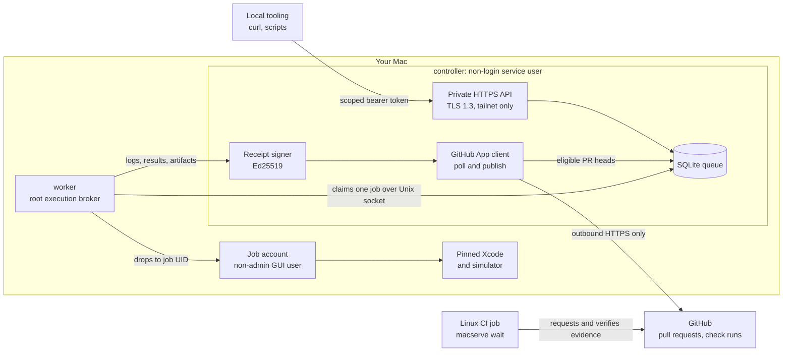

<div align="center">


# macserve

**Use your own Mac as a private iOS build-and-test service.**

[](https://github.com/jerryfane/macserve/actions/workflows/ci.yml)
[](https://github.com/jerryfane/macserve/releases/latest)
[](LICENSE)
[](go.mod)

[Quick start](#quick-start) · [How it works](#how-it-works) · [Security model](#security-model) · [Docs](#documentation)

</div>

Submit an exact Git commit, pick a pinned Xcode toolchain, and get back logs, test results, screenshots and a
signed evidence receipt. Jobs run natively on your Mac under a dedicated non-admin account, one at a time, at low
priority, and you can pause them whenever you need the machine. GitHub integration is pull-based, so your CI never
needs network credentials for your private network. No VM required.

## Why macserve

- **Your Mac, your Xcode.** Builds run on hardware you already own, against the exact Xcode build and simulator
  runtime you pinned.
- **Nothing inbound.** The Mac polls GitHub and publishes check runs itself; GitHub never connects to it, and no App
  secret or Mac API token belongs in Actions.
- **Evidence, not just a green tick.** Results come with a signed receipt binding the repository, commit, tree,
  toolchain, runtime, exit status, test counts and log/artifact digests.
- **It stays your computer.** One job at a time, background priority, memory and disk budgets, and a persisted
  pause/drain switch.

## Features

| Feature | What you get |
| --- | --- |
| **Exact commits** | `build`, `unit_test`, `simulator_ui_test` and template-only `simulator_script` and `ios_archive` (unsigned release archive, signed by the optional code signer and uploaded by the agent: [TestFlight](docs/testflight.md)) jobs for a repository at an exact 40-character commit SHA. |
| **Pinned toolchains** | The Xcode version and build, and the simulator runtime, are pinned per job. |
| **Zero-config onboarding** | Org-level templates: any repository of an approved GitHub owner builds, and runs sharded unit or UI tests on a pinned simulator, by committing a small `.macserve.json`. |
| **No command injection** | Controller-owned, versioned profiles and templates fix the xcodebuild command line; clients cannot inject shell commands, environment variables or paths. |
| **Rich results** | Status, paged and streamed (SSE) logs, an `xcresult` summary as JSON or JUnit, artifacts and range downloads. |
| **Signed receipts** | Ed25519 signatures over RFC 8785 canonical JSON, verified against pinned keys. |
| **GitHub pull mode** | A GitHub App polls allowlisted repositories and publishes `mac-evidence/<profile>` check runs, which can be required checks. |
| **Linux CI waiter** | `macserve wait` lets a Linux workflow request exact-head evidence and verify the pinned receipt. |
| **Agent-side TestFlight upload** | `macserve testflight-upload` verifies a signed job's signer receipt and `App.ipa`, then uploads it through the App Store Connect Build Upload API with keyring-signed JWTs; no Apple key on the Mac or in the agent. [Details](docs/testflight.md). |
| **Fail-closed health** | Short-lived, root-owned host health; missing, stale or changed qualification stops admission and cancels active work. |

## How it works



1. A job arrives either through the private API or because the GitHub App poller saw an eligible open PR head.
2. The controller fetches the exact commit, verifies its tree and exports the full source; jobs wait in a durable
   SQLite queue that admits one active execution at a time.
3. The root worker broker claims the job over a Unix socket and runs the fixed recipe inside the dedicated job
   account's existing GUI session, with the pinned Xcode and, where the job needs one, its own simulator.
4. Test evidence is parsed independently, artifacts are stored immutably, and the controller signs a receipt.
   GitHub gets a check run with a compact signed receipt; full manifests stay behind authenticated downloads.

Details: [architecture](docs/architecture.md) · [receipts and GitHub](docs/receipts-and-github.md).

## Quick start

**1. Install on the Mac.** Each release ships a CGO-disabled, `-trimpath` Darwin arm64 binary and `SHA256SUMS`;
no Go toolchain is needed on the host. Check out the reviewed release tag for its install assets, download the
binary, and set `EXPECTED_SHA256` to the reviewed digest (a checksum downloaded beside a binary detects corruption,
not a compromised release). Write `deploy.env` from the documented sample, then run the installer; by default it
is a nonprivileged plan that verifies the binary digest without creating accounts or installation files:

```sh
git clone --depth 1 --branch "$RELEASE_TAG" https://github.com/jerryfane/macserve.git macserve-deploy-kit
cd macserve-deploy-kit
gh release download "$RELEASE_TAG" --repo jerryfane/macserve \
  --pattern macserve-darwin-arm64 --pattern SHA256SUMS
/bin/bash assets/install.sh --env deploy.env \
  --binary macserve-darwin-arm64 --sha256 "$EXPECTED_SHA256"
```

Applying the install, creating the job account, qualifying the host and enabling the services are separate
owner-approved sittings; follow the [Quick path](docs/install.md#quick-path) in the installation guide.

**2. Onboard a repository.** For a repository owned by an account listed in an enabled, qualified template (and
with no explicit per-repository profile of the same kind), commit a `.macserve.json` at the repository root. That
is the whole per-repository setup:

```json
{"version": 1, "work_dir": "ios", "project": "App.xcodeproj", "scheme": "App", "xcodegen": true, "resolve_packages": true}
```

Use exactly one of `project` or `workspace`; `xcodegen` and `resolve_packages` are optional. For test templates, add
`ui_test` and/or `unit_test` sections of named shards (`{"shards": {"terminal": ["AppUITests/TerminalTests"]}}`,
selectors `Target/Class` or `Target/Class/method`); a test job names one shard with `"shard"` and runs exactly its
selectors, which its receipt requires to have executed. Flutter templates (a template with a pinned Flutter
version) serve repositories that add a `flutter` section (`{"app_dir": "apps/mobile"}`, with `work_dir`
`apps/mobile/ios` and `workspace` `Runner.xcworkspace`); their jobs name `"flutter": {"version": ...}` and run the
pinned root-owned Flutter, Ruby and CocoaPods. Repository content cannot choose executables, flags,
environment, destinations, configurations or signing. Full rules:
[Onboarding a repository](docs/install.md#onboarding-a-repository).

**3. Submit a job.** On the Mac, from the repository root, after pushing the commit:

```sh
macserve build            # --repo from remote "origin", --sha from HEAD; --profile ID if several match
```

It reads the API token from your login keychain (item `macserve API token`, saved by `macserve setup`; never
printed), checks `.macserve.json` without running anything, submits through `/v1/jobs` with an `Idempotency-Key`,
prints the logs and verifies the signed receipt against `/Library/macserve/config/deployment-pins.json`. Exit 0
means the job succeeded and its receipt verifies. `macserve doctor` (read-only; `--json` for machine output,
`sudo` for the root-only checks, `sudo macserve doctor --live` adds Full Disk Access and GitHub App checks)
explains a host that does not admit jobs.

From another machine, use the API directly. It listens only on the Mac's tailnet address, over TLS 1.3 with the
installer-generated certificate. The request must carry the template's exact Xcode pins, which
`GET /v1/capabilities` reports:

```sh
MACSERVE=https://100.64.0.10:8443          # your controller's tailnet address and port
CURL=(curl -fsS --cacert tls-cert.pem -H "Authorization: Bearer $MACSERVE_TOKEN")

XCODE=$("${CURL[@]}" "$MACSERVE/v1/capabilities" |
  jq -c '.templates[] | select(.id == "org-ios-sim-build-v1") | .xcode')

JOB=$(jq -n --arg sha "$(git rev-parse HEAD)" --argjson xcode "$XCODE" \
  '{repo: "your-org/your-app", sha: $sha, kind: "build", profile: "org-ios-sim-build-v1", xcode: $xcode}' |
  "${CURL[@]}" -X POST "$MACSERVE/v1/jobs" \
    -H "Content-Type: application/json" -H "Idempotency-Key: $(uuidgen)" --data-binary @- |
  jq -r .id)

"${CURL[@]}" "$MACSERVE/v1/jobs/$JOB"          # status
"${CURL[@]}" "$MACSERVE/v1/jobs/$JOB/logs"     # paged logs (or /logs/stream for SSE)
"${CURL[@]}" "$MACSERVE/v1/jobs/$JOB/results"  # xcresult summary (or /results/junit)
"${CURL[@]}" "$MACSERVE/v1/jobs/$JOB/receipt"  # signed receipt; 409 until one exists
```

`tls-cert.pem` is the controller certificate installed at `/Library/macserve/config/tls-cert.pem`. The token needs
the `jobs:submit` and `jobs:read` scopes for that repository (or an `owner/*` entry). Resending the identical
request with the same `Idempotency-Key` returns the existing job; a different request under that key is refused.
All routes, including cancel, artifacts and admin pause, are listed in [configuration.md](docs/configuration.md).

## Security model

- **Separate identities.** The controller runs as a dedicated non-login service user. The root worker broker drops
  supplementary groups, GID and UID into a dedicated non-admin job account (by default shown as “macserve build”)
  that may belong to neither `staff` nor `admin`. No HTTP API or credential-bearing service runs as root.
- **Fixed recipes.** Profiles and templates are controller-owned. No signing credentials are ever given to build jobs.
- **Private, authenticated API.** TLS 1.3 on a literal tailnet address only; LAN, public, wildcard and loopback
  listeners are refused. Bearer tokens are scoped per repository and only their SHA-256 digests are persisted.
- **Fail closed.** Execution stays disabled without fresh root-managed host and toolchain qualification.
- **Verifiable output.** Receipts are signed with a controller-only Ed25519 key; pin public keys out of band.

**Limits you should know about.** macserve is **not a hostile-code sandbox**: jobs share the host's kernel,
hardware and network reachability, so only run repositories you trust, including their writers, build scripts and
dependencies. **Phase 1 provides no network isolation**: macserve installs no PF rules, and the job account may
reach loopback, LAN, tailnet and internet destinations. Provisioning must still deny the job account access to
owner files, keychains and service credentials. See [architecture.md](docs/architecture.md) for the full boundary.

## Status and roadmap

macserve is in early development. It has been running in production on one Mac Studio since 2026-11-02, where a
real app build completed end to end.

The private controller API, durable queue, exact source exporter, protected worker, GitHub polling, signed
receipts, Linux waiter and reviewed deployment tooling are implemented. The protected root execution broker
requires a separate non-admin GUI job account and an explicitly qualified process baseline. Privileged
deployment and background GUI operation have not been qualified by the automated test suite.

**What it does not do (yet)**

- **No code signing, archiving, App Store Connect or TestFlight in phase 1.**
- **No network isolation in phase 1.** PF enforcement may be a separately reviewed future opt-in; it is not
  implemented or implied by phase-1 health.
- No VM management, no device farm, no multi-host scheduling.
- GitHub merge-queue (`merge_group`) evidence is not implemented.

## Documentation

| Document | Contents |
| --- | --- |
| [Installation guide](docs/install.md) | Owner-approved deployment sittings, onboarding, qualification, recovery |
| [Architecture](docs/architecture.md) | Components, package reference, store/worker limits, network isolation |
| [Configuration](docs/configuration.md) | Controller configuration, principals and scopes, HTTP API, budgets |
| [Receipts and GitHub](docs/receipts-and-github.md) | Signed receipts, GitHub pull mode, PR comment grammar, Linux waiter |
| [Host health](docs/host-health.md) | Installation assets, owner-home rules, maintenance health publication |
| [Persistence policy](docs/persistence-policy.md) | Reviewed registration-persistence policy and its migration |

## Development

Use the Go version declared in `go.mod`. SQLite uses a pure-Go driver; no external database is required.

```sh
GOMAXPROCS=2 nice -n 10 go vet -p 2 ./...
GOMAXPROCS=2 nice -n 10 go test -p 2 ./...
GOMAXPROCS=2 nice -n 10 go run -p 2 ./cmd/macserve --help
```

`macserve --help` and `macserve <command> --help` exit 0. Service commands require `--config`; invalid or
missing arguments exit 2. Runtime safety failures exit 1. Help goes to stdout and errors to stderr.

CI pins third-party actions to immutable commit SHAs and runs vet, tests and a CLI build on GitHub-hosted
`ubuntu-latest` and `macos-latest`. Apple tool execution is faked in tests: no simulator boot or app build is
performed. Native process tests use harmless owned Go helpers, including a session-escaping child with
cleanup restricted to that exact PID. Privilege transitions use injected seams, not privileged test execution.
Linux exercises portable behavior but is not a supported Apple worker host.

## Contributing

Issues and pull requests are welcome. Keep changes focused and run the development commands above before opening
a pull request; CI repeats vet, tests and a CLI smoke check on Linux and macOS. Changes that touch security
boundaries, deployment or evidence should state what they do and do not prove.

## License

[Apache-2.0](LICENSE)
