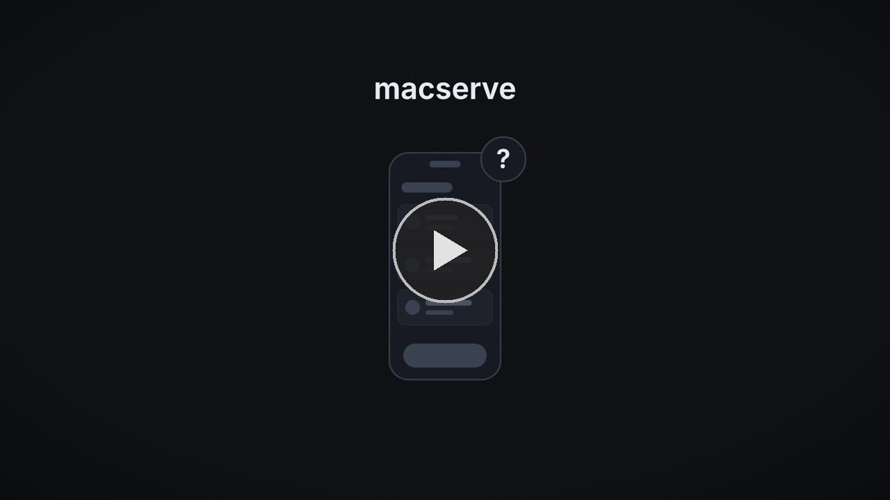
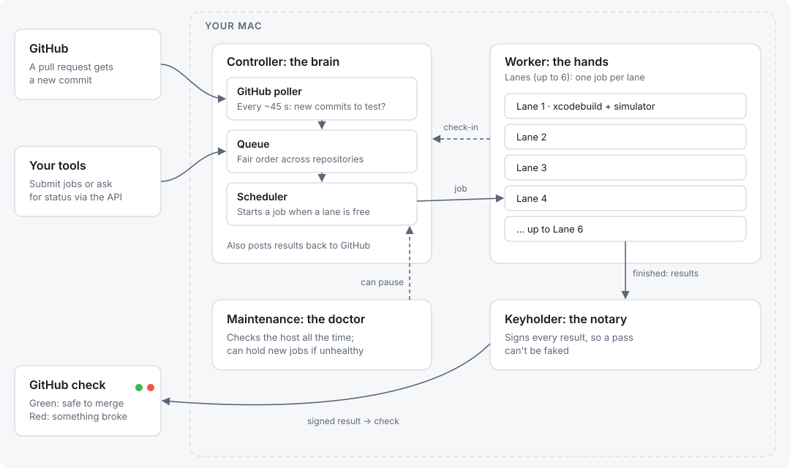

<div align="center">


# macserve

**Use your own Mac as a private iOS build-and-test service.**

[](https://github.com/jerryfane/macserve/actions/workflows/ci.yml)
[](https://github.com/jerryfane/macserve/releases/latest)
[](LICENSE)
[](go.mod)

[Install](#install) · [How it works](#how-it-works) · [Security](#security-in-brief) · [Docs](#documentation)

</div>

macserve turns a Mac you own into a build-and-test machine for your iOS apps. When a pull request gets a new
commit, your Mac builds and tests that exact commit with the Xcode version you chose. It sends the result back to
GitHub as a pass or fail check, with a signed receipt that proves what ran.

[](docs/assets/macserve-explainer.mp4)

*Watch the 4-minute explainer (opens the video page).*

## Why macserve

- **Your Mac, your Xcode.** Builds run on hardware you already own, with the Xcode and simulator you pinned.
- **Nothing comes in.** The Mac asks GitHub for work and posts results itself. GitHub never connects to it.
- **Proof, not just a tick.** Each result has a signed receipt for the commit, the tools, the tests and the logs.
- **It stays your computer.** Jobs run at low priority under their own account, and you can pause them anytime.

| | GitHub-hosted macOS runner | Self-hosted runner | macserve |
| --- | --- | --- | --- |
| Hardware | 3 cores (M1), 7 GB | Your Mac | Your Mac |
| Cost | $0.062 per minute | Your own hardware | Your own hardware |
| What runs | The workflow file | The workflow file, and a pull request can change it | Build recipes the Mac owner set; the repository's own build scripts still run |
| Recommended for | Any repository | Private repositories only (GitHub's advice) | Repositories you trust |
| Result | A check | A check | A check plus a signed receipt |

## How it works

<picture>
  <source media="(prefers-color-scheme: dark)" srcset="docs/assets/how-it-works-dark.svg">
  
</picture>

1. A pull request gets a new commit, or you submit a job yourself.
2. The controller fetches that exact commit and puts the job in a fair queue.
3. The worker runs it in a free lane (up to 6), as a separate non-admin user, with the pinned Xcode.
4. The results are collected: logs, test counts, screenshots and other files.
5. The keyholder signs a receipt, so a pass can't be faked.
6. GitHub shows a pass or fail check on the pull request.

Details: [architecture](docs/architecture.md) · [receipts and GitHub](docs/receipts-and-github.md).

## Install

On an Apple silicon Mac, as yourself (an administrator):

```sh
brew tap jerryfane/macserve        # then trust the tap, as Homebrew 6 requires
brew install macserve
macserve setup --plan --repository OWNER/NAME:ID   # read-only: checks the Mac, changes nothing
macserve setup --repository OWNER/NAME:ID --sha256sums SHA256SUMS
```

`--sha256sums` is the release's `SHA256SUMS`; download and verify it first, as the guide shows. Installation
involves several owner-approved steps (your password, Full Disk Access, one login to the build account, host
qualification), and setup resumes where it stopped. Read the [installation guide](docs/install.md#quick-path) first.

## Onboard a repository

Commit a `.macserve.json` at the repository root:

```json
{"version": 1, "work_dir": "ios", "project": "App.xcodeproj", "scheme": "App", "xcodegen": true, "resolve_packages": true}
```

To run tests on several lanes at once, split them into named shards. Full rules:
[Onboarding a repository](docs/install.md#onboarding-a-repository).

## Run a job

On the Mac, from the repository root, after pushing the commit:

```sh
macserve build     # builds HEAD, prints the logs and verifies the signed receipt
macserve doctor    # read-only: explains why a Mac does not take jobs
```

Other machines can use the private HTTPS API on your tailnet; see [the API and a curl example](docs/configuration.md#example-submit-a-job-with-curl).

## Security in brief

- **Separate accounts.** The service runs as a non-login user; jobs run as a separate non-admin build account.
- **Fixed recipes.** The Mac owner's templates fix the build commands; a repository cannot add commands or flags.
- **Private API.** TLS 1.3 on a tailnet address only, with per-repository tokens stored as digests.
- **Fail closed.** No jobs run without fresh host and toolchain checks.
- **Signed results.** A separate keyholder signs receipts; pin its public key out of band.

**Limits.** macserve is **not a hostile-code sandbox**: jobs share the Mac's kernel, hardware and network, so only
build repositories you trust, including their writers and dependencies. There is **no network isolation**: the
build account can reach the local network, the tailnet and the internet. See [architecture](docs/architecture.md).

## Status

Early development, running in production on one Mac Studio since 2026-11-02. It runs several jobs at once in
lanes (up to 6). Archiving, code signing through an optional signer and [TestFlight upload](docs/testflight.md)
are available. Not implemented: merge queue (`merge_group`) checks, network isolation, VM management, a device
farm and multi-host scheduling.

## Documentation

| Document | Contents |
| --- | --- |
| [Installation guide](docs/install.md) | Setup, onboarding, qualification, upgrades, recovery |
| [Architecture](docs/architecture.md) | Components, security boundary, limits |
| [Configuration](docs/configuration.md) | Controller settings, tokens and scopes, HTTP API, lanes |
| [Receipts and GitHub](docs/receipts-and-github.md) | Signed receipts, GitHub checks, Linux waiter |
| [TestFlight](docs/testflight.md) | Archive, signing and upload |
| [Host health](docs/host-health.md) | Installed assets and host health |
| [Persistence policy](docs/persistence-policy.md) | Reviewed login-item and agent policy |
| [Releases](docs/releases.md) | Release workflow, signed manifest, carry releases, Homebrew tap |

## Development

Use the Go version in `go.mod`. Tests fake Apple tools; they never boot a simulator or build an app.

```sh
GOMAXPROCS=2 nice -n 10 go vet -p 2 ./...
GOMAXPROCS=2 nice -n 10 go test -p 2 ./...
```

## Contributing

Issues and pull requests are welcome. Keep changes focused and run the commands above first. Changes to security
boundaries, deployment or evidence should say what they do and do not prove.

## License

[Apache-2.0](LICENSE)
